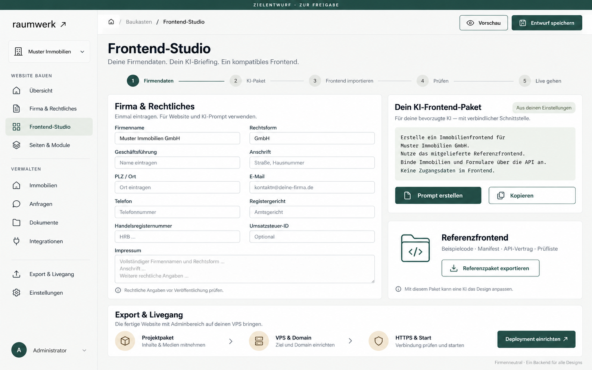

# GUI-Entwurf für den Baukasten

**Status: Am 27.10.2026 freigegeben und umgesetzt.** Das Bild bleibt als ursprünglicher Zielentwurf erhalten. Echte Bilder der implementierten Oberfläche stehen unter [Screenshots](../screenshots/README.md).

[Bild in voller Größe öffnen](baukasten-gui.png)

Der Entwurf zeigt einen firmenneutralen Baukasten mit Firmendaten und rechtlichen Angaben, einem KI-Prompt samt kompatiblem Referenzfrontend sowie dem geplanten Ablauf für Import, Prüfung und VPS-Deployment. „Muster Immobilien“ dient nur als Beispieldatensatz.
